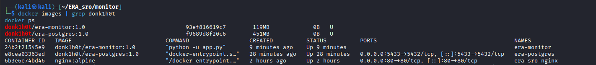
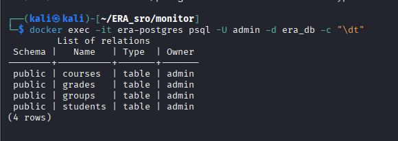
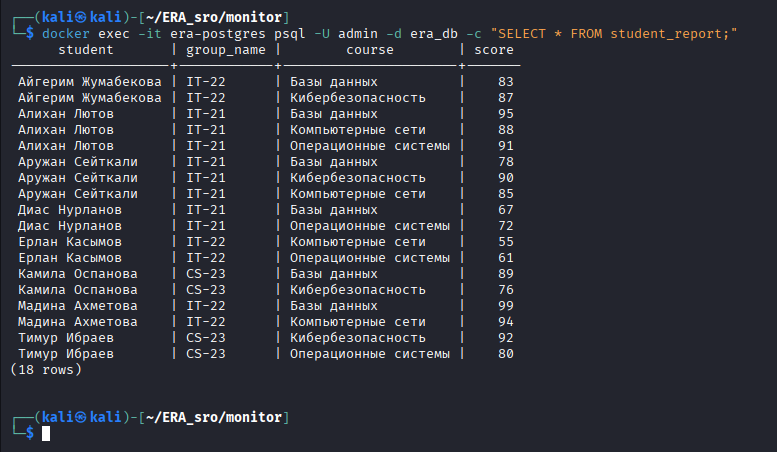
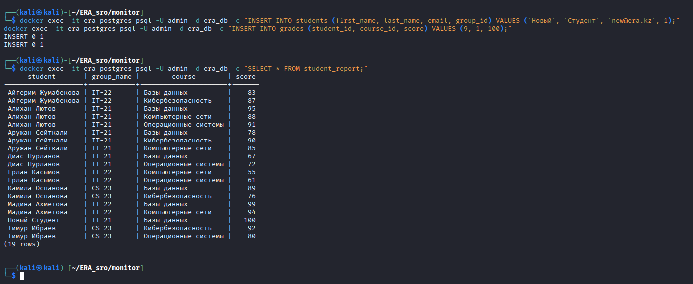
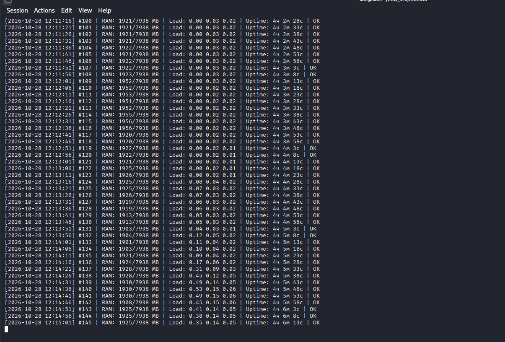
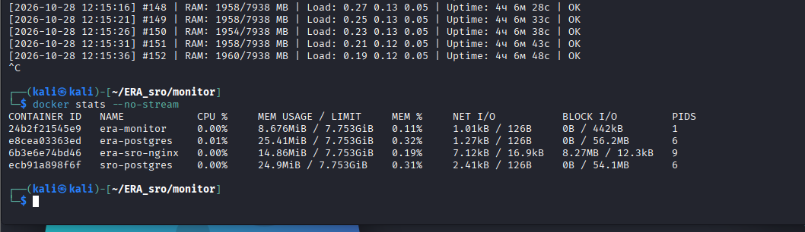

# Отчёт по самостоятельной работе (СРО)

## 1. Цель работы

1. Разместить статический веб-сайт в облачном хранилище Amazon S3 и обеспечить доступ к нему из сети Интернет.
2. Изучить работу с реестром образов Docker Hub.
3. Развернуть в виде контейнеров два приложения, не являющихся веб-серверами, выполнить их собственную настройку и опубликовать полученные образы в Docker Hub.

Ссылка на docker.com : https://app.docker.com/accounts/donk1h0t

## 2. Структура репозитория

```
.
├── README.md                      Отчёт
├── Site-f.html                    Страница сайта для Amazon S3
├── Фото отчет AWS/                Снимки экрана по части 1
└── Docker/
    ├── postgres/
    │   ├── Dockerfile             Образ PostgreSQL с собственной базой данных
    │   └── init.sql               Скрипт создания и заполнения базы данных
    ├── monitor/
    │   ├── Dockerfile             Образ приложения мониторинга
    │   └── app.py                 Исходный код приложения мониторинга
    └── screenshots/               Снимки экрана по части 2
```

---

## 3. Часть 1. Размещение статического сайта в Amazon S3

### 3.1. Порядок выполнения

1. В сервисе Amazon S3 создан бакет `my-1site` в регионе Asia Pacific (Sydney), `ap-southeast-2`.
2. В бакет загружен файл страницы `Site-f.html`.
3. В свойствах бакета включена функция Static website hosting, в качестве индексного документа указан `Site-f.html`.
4. Отключена блокировка публичного доступа (Block all public access).
5. Добавлена политика бакета, разрешающая публичное чтение объектов:

```json
{
  "Version": "2012-10-17",
  "Statement": [
    {
      "Sid": "PublicReadGetObject",
      "Effect": "Allow",
      "Principal": "*",
      "Action": "s3:GetObject",
      "Resource": "arn:aws:s3:::my-1site/*"
    }
  ]
}
```

6. Сайт стал доступен по адресу:
   `http://my-1site.s3-website-ap-southeast-2.amazonaws.com`

### 3.2. Результаты

**Рисунок 1.** Созданный бакет `my-1site`


**Рисунок 2.** Настройка Static website hosting


**Рисунок 3.** Политика бакета для публичного доступа


**Рисунок 4.** Свойства бакета


**Рисунок 5.** Сайт открыт в браузере по адресу S3


**Рисунок 6.** Сайт открыт в режиме инкогнито, что подтверждает публичный доступ


---

## 4. Часть 2. Контейнеризация приложений в Docker

### 4.1. Исходные данные

| Параметр | Значение |
|---|---|
| Операционная система | Kali Linux 2025.3 (VMware Workstation) |
| Средство контейнеризации | Docker |
| Реестр образов | Docker Hub, учётная запись `donk1h0t` |

В качестве базовых образов использованы официальные образы из Docker Hub: `postgres:16` и `python:3.12-slim`.

### 4.2. Приложение 1. СУБД PostgreSQL с собственной базой данных

**Назначение.** Хранение учебных данных университета: группы, студенты, дисциплины и оценки.

**Собственная настройка.** В образ добавлен скрипт `init.sql`, который при первом запуске контейнера автоматически создаёт базу данных `era_db`:

| Таблица / представление | Содержимое |
|---|---|
| `groups` | Учебные группы |
| `students` | Студенты, связаны с группами внешним ключом |
| `courses` | Дисциплины и преподаватели |
| `grades` | Оценки студентов по дисциплинам (ограничение 0–100) |
| `student_report` | Представление (VIEW), объединяющее данные всех таблиц |

**Dockerfile** (`Docker/postgres/Dockerfile`):

```dockerfile
FROM postgres:16
ENV POSTGRES_USER=admin
ENV POSTGRES_PASSWORD=admin123
ENV POSTGRES_DB=era_db
COPY init.sql /docker-entrypoint-initdb.d/
```

**Сборка, запуск и публикация:**

```bash
cd Docker/postgres
docker build -t donk1h0t/era-postgres:1.0 .
docker run -d --name era-postgres -p 5433:5432 donk1h0t/era-postgres:1.0
docker push donk1h0t/era-postgres:1.0
```

Внешний порт 5433 выбран потому, что порт 5432 на хосте был занят другим экземпляром PostgreSQL.

**Проверка работы:**

```bash
docker exec -it era-postgres psql -U admin -d era_db -c "\dt"
docker exec -it era-postgres psql -U admin -d era_db -c "SELECT * FROM student_report;"
```

### 4.3. Приложение 2. Сервис мониторинга системы ERA Monitor

**Назначение.** Консольное приложение на языке Python, которое с заданным интервалом записывает в журнал состояние системы: объём занятой оперативной памяти, среднюю загрузку процессора и время работы. При использовании более 90 % памяти выводится предупреждение.

**Собственная настройка.** Приложение разработано самостоятельно (`Docker/monitor/app.py`) и использует только стандартную библиотеку Python. Параметры задаются через переменные окружения без пересборки образа:

| Переменная | Значение по умолчанию | Назначение |
|---|---|---|
| `APP_NAME` | `ERA Monitor` | Название, выводимое при запуске |
| `INTERVAL` | `5` | Интервал между проверками, в секундах |

**Dockerfile** (`Docker/monitor/Dockerfile`):

```dockerfile
FROM python:3.12-slim
WORKDIR /app
COPY app.py .
ENV APP_NAME="ERA Monitor"
ENV INTERVAL=5
CMD ["python", "-u", "app.py"]
```

**Сборка, запуск и публикация:**

```bash
cd Docker/monitor
docker build -t donk1h0t/era-monitor:1.0 .
docker run -d --name era-monitor donk1h0t/era-monitor:1.0
docker push donk1h0t/era-monitor:1.0
```

**Проверка работы:**

```bash
docker logs -f era-monitor
docker run -d --name era-monitor2 -e INTERVAL=1 -e APP_NAME="Demo Monitor" donk1h0t/era-monitor:1.0
```

### 4.4. Опубликованные образы

| Образ | Ссылка |
|---|---|
| `donk1h0t/era-postgres:1.0` | https://hub.docker.com/r/donk1h0t/era-postgres |
| `donk1h0t/era-monitor:1.0` | https://hub.docker.com/r/donk1h0t/era-monitor |

Получить образы на любом компьютере с Docker:

```bash
docker pull donk1h0t/era-postgres:1.0
docker pull donk1h0t/era-monitor:1.0
```

### 4.5. Результаты

**Рисунок 7.** Собранные образы и запущенные контейнеры (`docker images`, `docker ps`)



**Рисунок 8.** Таблицы базы данных `era_db`



**Рисунок 9.** Результат запроса к представлению `student_report`



**Рисунок 10.** Добавление новых записей в базу данных



**Рисунок 11.** Журнал работы приложения ERA Monitor



**Рисунок 12.** Потребление ресурсов контейнерами (`docker stats`)



---

## 5. Сравнение способов развёртывания

| Критерий | Docker (локально) | Cloudflare Tunnel | Amazon S3 |
|---|---|---|---|
| Доступ из сети Интернет | Нет | Да | Да |
| HTTPS | Нет | Да, автоматически | Только через CloudFront |
| Работа без включённого компьютера | Нет | Нет | Да |
| Постоянный адрес | Нет | Нет (для быстрого туннеля) | Да |
| Поддержка серверной части и БД | Да | Да | Нет, только статические файлы |
| Стоимость | Бесплатно | Бесплатно | В рамках Free Tier |

---

## 6. Вывод

В ходе работы был размещён статический веб-сайт в Amazon S3: настроены хостинг статического сайта и политика публичного доступа, сайт доступен из сети Интернет.

Также были развёрнуты два контейнерных приложения, не являющихся веб-серверами: СУБД PostgreSQL с автоматически создаваемой базой данных и собственное приложение мониторинга на Python. Для каждого приложения написан Dockerfile, образы собраны, проверены и опубликованы в Docker Hub, откуда их можно получить командой `docker pull`.

Работа показала, что Docker позволяет упаковать приложение вместе с настройками и данными в переносимый образ, а облачное хранилище Amazon S3 подходит для размещения статических сайтов без собственного сервера.
